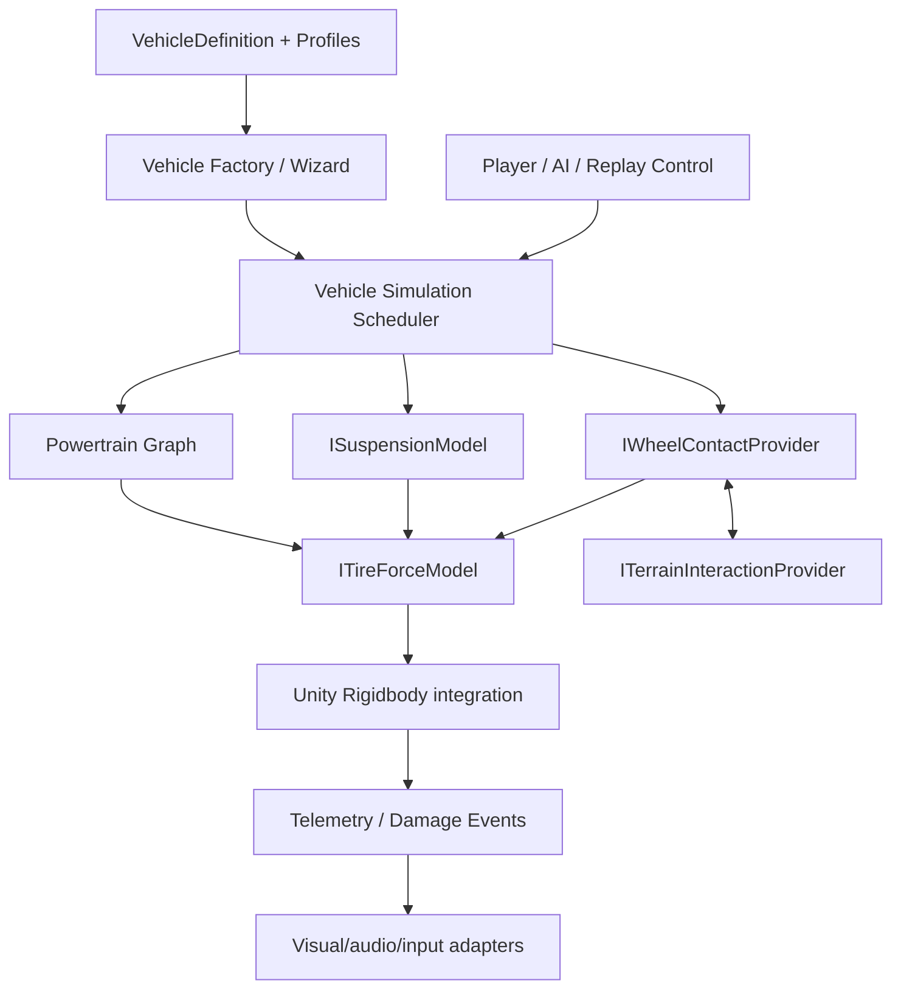

# 03 — Modüler sistem mimarisi

## Genel veri akışı



Bu bir hedef mimari diyagramıdır; M0'ın uygulanmış mimarisini göstermez.

## Bileşen sözleşmeleri — hedef arayüzler

Aşağıdaki ifadeler **önerilen API sözleşmeleridir** (henüz C# olarak
uygulanmamıştır).

- `IVehicleController`: normalize sürücü hedef girdilerini üretir.
- `IWheelContactProvider`: fizik sahnesinden temas patch'i, yüzey normalini,
  efektif temas merkezini ve zemin kimliğini döndürür.
- `ISurfaceProvider`: `SurfaceProfile` ve mevcut zemin durumunu döndürür.
- `ITerrainInteractionProvider`: sinkage/direnç/deformasyon; ihtiyaç yoksa NoOp.
- `ITireForceModel`: uzunlamasına/yanal kuvvet ve hizalama momenti üretir.
- `ISuspensionModel`: stroke, stroke rate, spring/damper/bumpstop kuvveti.
- `IDrivetrain`: güç kaynağından tahrikli tekerleklere tork dağıtır.
- `ISteeringSystem`: direksiyon girdi → tekerlek hedef açıları.
- `IBrakeSystem`: servis/park/yardımcı fren torku.
- `IVehicleAssistance`: ABS/TCS/ESC veya arcade müdahalesi.
- `IVehicleTelemetrySink`: tekerlek/gövde/aktarma ölçümlerinin tüketicisi.

## Sorumluluk sınırları

**Definition / Settings**: immutable okunması tercih edilen ScriptableObject
parametreleri. Araç tipi, tekerlekler, akslar, sertlikler, tork eğrileri.

**State**: zamanla değişen tekerlek açısal hızı, sıkışma, kayma, sıcaklık,
yük, motor devri, kavrama durumu, hasar vb. Definition içinde tutulmaz.

**Solver**: state + definition + scene query + dt alır; kuvvet/tork hesaplar.

**Integrator**: Unity `Rigidbody.AddForceAtPosition` ve gövde integrasyonu;
çift integrasyon yapılmaz. Tekerlek açısal ivmesi ayrı çözülür.

**Presentation**: tekerlek mesh animasyonu, direksiyon simidi, ses, duman,
partikül ve telemetry UI; fizik değerlerini okuyabilir ama onları kontrol
etmek zorunda değildir.

## Tek gövde / çok gövde ayrımı

`VehicleDefinition`: tek rigid-body gövde ve ona ait aks/tekerlekler.

`VehicleAssembly`: birden fazla `VehicleDefinition` ve `Coupling` içerir.
Örneğin çekici 10 + römork 8 tekerlek → **18 tekerlek, en az iki Rigidbody**.
Körüklü otobüs ve çok bölümlü iş makineleri de aynı multi-body sözleşmeyi
kullanabilir. KAVRA M0 Wizard yalnızca tek gövde örneği oluşturur.

## Çift lastik / aks tanımı

- Bir aksın farklı montaj noktalarında tekil `Wheel` kayıtları olabilir.
- Her Wheel kendi yükünü ve yüzey temasını hesaplar.
- İki yan yana lastik aynı aks/süspansiyon grubunun yükünü paylaşabilir.
- Bazı aksların kaldırma/boşta sürüş modu sonraki aşamada tanımlanır.
- Aks ID'leri ve Wheel ID'leri stabil olmalı; prefab serialize/migration için
  isim bazlı değil kimlik bazlı eşleştirme gerekir.

## Zaman çizelgesi — hedef

1. Kullanıcı/AI/sürüş yardım komutlarını yakala ve sabit adım girdisini üret.
2. Şasi hızları ve eski tekerlek durumundan temas sorgularını al.
3. Süspansiyon stroke/damper kuvvetlerini hesapla.
4. Lastik–zemin ve aktarma grafiği ilişkisini substep/iterasyonla çöz.
5. Gövdeye kuvvetleri doğru dünya noktalarından ilet.
6. Rigidbody fizik adımı sonunda telemetri ve sunum sistemlerini güncelle.

Özellikle lastik torku ile tekerlek kayma kuvveti geri beslemelidir;
kesin çözüm sırası/iteratif yaklaşım M0 deneyleriyle belirlenecek.

## Modül dosya organizasyonu — hedef

```
Runtime/{Core,Dynamics,Wheels,Suspension,Powertrain,Controls,Surfaces,Telemetry}
Runtime/Optional/{Terrain,Damage}
Editor/{Wizard,Inspectors,Gizmos,Validation}
Tests/{Editor,Runtime,Performance}
Samples~/{QuickStart,PhysicsLab}
```

M0 paketinde yalnızca gerçekten kullanılan küçük bir alt küme vardır;
bu hedef klasörlerini boş ve sahte implementasyonlarla doldurmuyoruz.

## Veri sürümleme ve API disiplini

- Asset migration yolu olmadan serialize alanlarını yeniden adlandırma.
- Parametreler SI biriminde, anlamlı bounds ile tanımlanacak.
- Physics core, URP / UI Toolkit / Input System türleriyle bağımlı olmamalı.
- M0 `0.0.1` API henüz kararlı değil. M1 öncesi isimler değişebilir.


## M1 core implementation update (2026-10-14)

The earlier `Powertrain Graph` in the target diagram remains a future
fully coupled multi-source architecture. The first **real** implementation
is `SimplePowertrainDefinition` + `SimplePowertrainRuntime`, which
provides a separate data asset, per-car dynamic state, engine torque
curve, gearbox ratios, final drive and explicit driven-wheel outputs.
`VehicleSimulationRoot` still owns the Rigidbody integration, and
wheels/tire solver remain separate. `DriveSource` explicitly chooses
legacy direct torque or simple powertrain; input/replay/camera stay in
optional host adapters.

The runtime's topology consists of **AxleId groupings** (not a fixed array
of four corners): total gearbox/final-drive torque is shared equally among
driven axle groups and then among driven wheel elements in each axle.
This provides honest initial functionality for 3W to 20W single-chassis
presets while reserving actual differential clutch reactions and
torque biasing for M2. Multi-body tractor/trailer remains a separate
VehicleAssembly future milestone.


## M1.1 axle torque routing

The SimplePowertrainRuntime accepts optional AxleDefinition instances
for each driven AxleId group. Weighting between axle groups is data-driven
while the original wheel CanDrive layout remains the source of drive
eligibility. A temporary mode can bias wheel torque commands according to
wheel speed differences. It neither adds mechanical shaft constraints nor
modifies the collision/suspension/ground-tire solver.

This is a deliberate intermediate modular layer: full open diff, locked
differential and LSD mechanics can later implement proper output shaft
constraints behind the same public drive API. The KAVRA Wizard now exposes
per-axle drive enable and torque weight/mode without requiring a prefab
custom C# script.
